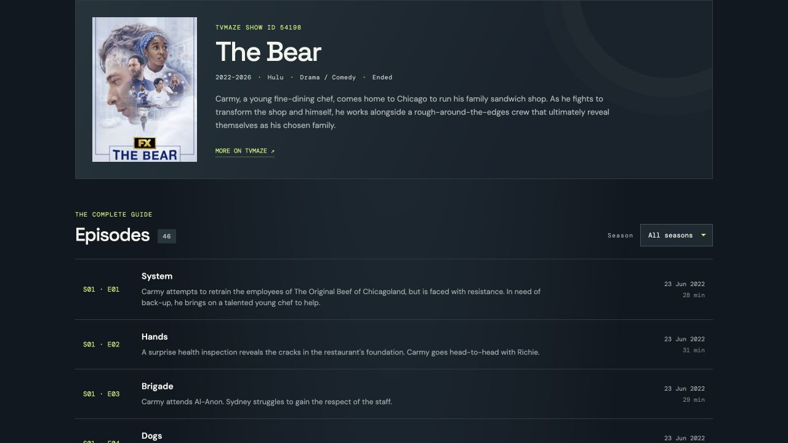

# Episode Atlas - TVmaze API guide

A responsive show search and episode guide powered by the public [TVmaze API](https://www.tvmaze.com/api). Search by title, choose the correct show, and browse its episodes using TVmaze's stable show ID.



*The screenshot demonstrates a live API response. Show images and programme data belong to their respective owners and are supplied by TVmaze.*

## Purpose

This project demonstrates how a browser application can collect JSON from a third-party REST API, resolve an ambiguous text search to a stable identifier, and turn the response into an accessible episode-guide interface without a framework or API key.

## Data collection

The user enters a show title. After at least two characters and a 300 ms debounce, the browser sends:

```text
GET https://api.tvmaze.com/search/shows?q={query}
```

The response contains possible `show` objects. When the user chooses one, the application uses its numeric `show.id` for two parallel requests:

```text
GET https://api.tvmaze.com/shows/{id}
GET https://api.tvmaze.com/shows/{id}/episodes
```

The JSON provides show metadata, images, summaries, and episode information. The page credits and links to TVmaze. Older in-flight searches are cancelled with `AbortController` when the query changes.

## Data persistence

Not applicable: the application does not save API responses or user searches. Matches and episodes are kept only in JavaScript memory for the open page. A season change filters the already loaded episode array and does not send another request. Reloading or closing the page clears all state.

## User interaction

1. Type at least two characters of a show name.
2. Choose a search result with the mouse or the Up/Down arrow keys.
3. Press Enter or click the result.
4. Read the show summary and episode list.
5. Use the season selector to filter the loaded episodes.

Loading, empty, and error states are announced in the page. Search results expose the network, date range, and TVmaze ID so similarly named shows can be distinguished.

## Setup, dependencies, configuration, and run

### Requirements

- A modern browser
- Internet access to `api.tvmaze.com` and TVmaze image URLs
- No API key, environment variables, package installation, build step, or server-side component
- Optional: Python 3 or another static server
- Optional: Node.js 18 or newer for the structural tests

### Quickest: open one file

Download `Episode-Atlas-Standalone.html` and open it in a browser. Its HTML, CSS, and JavaScript are contained in one file.

### Run the project files

1. Download or clone the repository.
2. Open `index.html` in a modern browser.
3. If local file requests are blocked, start a static server in the repository:

   ```bash
   python3 -m http.server 8000
   ```

4. Visit `http://localhost:8000`.

### Test

```bash
npm test
```

The tests use Node's built-in runner and syntax checker; no package installation is required.

## Project structure

| File | Purpose |
| --- | --- |
| `index.html` | Accessible page structure and controls |
| `styles.css` | Responsive visual design |
| `app.js` | API requests, cancellation, selection, filtering, and rendering |
| `Episode-Atlas-Standalone.html` | Downloadable single-file version |
| `tests/smoke.test.mjs` | Dependency-free structural checks |
| `package.json` | Test command only; there are no installed packages |
| `AUDIT.md` | Sanitized publication audit, fixes, and repeat checks |

## Learning, challenge, and solution

### What I learned

This was my first time learning what APIs are and how they work. I learned how a project can send a request to an API, receive a JSON response, and use that data in an interface. I also learned that the same idea can be applied to many future projects that need information from an external service.

### Challenge I encountered

My initial knowledge of APIs was zero, so concepts such as endpoints, requests, responses, JSON, search queries, and identifiers were all new to me. One specific example was understanding why a show name is not always unique and why the selected TVmaze `show.id` is needed to request the correct episodes.

### How I approached it

I searched online and used ChatGPT to learn the basic API concepts and how to apply them in JavaScript. I then worked through the project step by step: first understanding the search response, then selecting the correct show ID, and finally using that ID to load and display its episode data.

## Limitations

- The application requires TVmaze and an internet connection; API outages, rate limits, caching, or schema changes can affect it.
- There is no offline cache, favourites list, account, or cross-session history.
- All episodes are rendered into one list, which can be long for shows with many episodes.
- The split-file version requests font CSS from Google Fonts; system fallbacks are available, and the standalone file uses those fallbacks.
- Automated tests check structure and syntax but do not replace a live browser/API test.
- The standalone file duplicates the main HTML, CSS, and JavaScript and must be kept in sync when the project changes.

## Assistance, tools, and external code

This project was created and reviewed with assistance from ChatGPT/Codex for planning, code generation and refinement, test creation, documentation, and repository review. It uses standard HTML, CSS, JavaScript, the browser Fetch and DOM APIs, Node's built-in test runner, Google Fonts in the split-file stylesheet, and TVmaze's public API/data. No third-party JavaScript package or API key is included.

## API attribution and terms

- TVmaze API documentation: <https://www.tvmaze.com/api>
- Show search example: <https://api.tvmaze.com/search/shows?q=girls>
- Episode list example: <https://api.tvmaze.com/shows/1/episodes>

TVmaze documents current rate limits, caching, and data-use requirements. This learning project is not affiliated with TVmaze.

Built for the Applied Programming & AI Fundamentals course.
